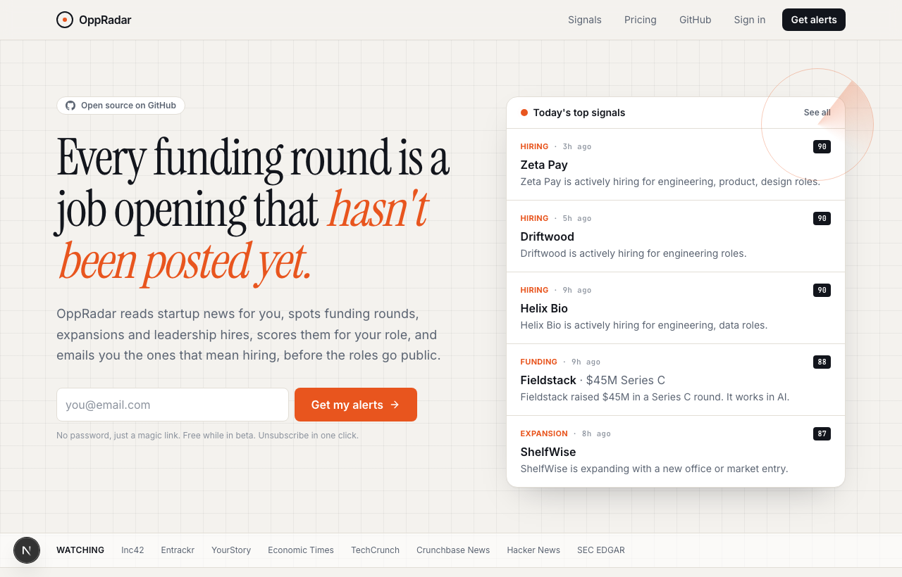
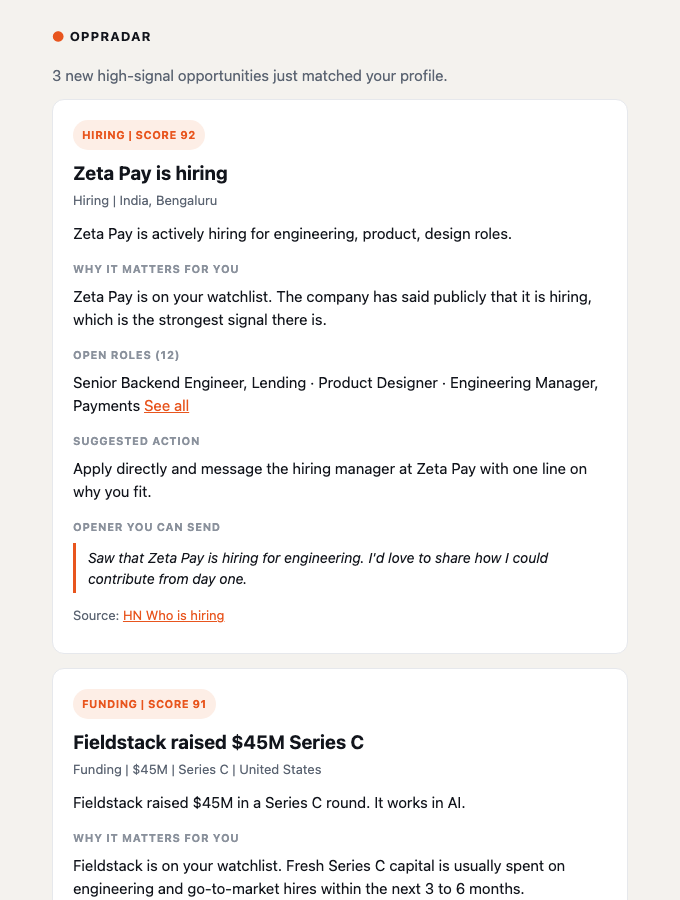
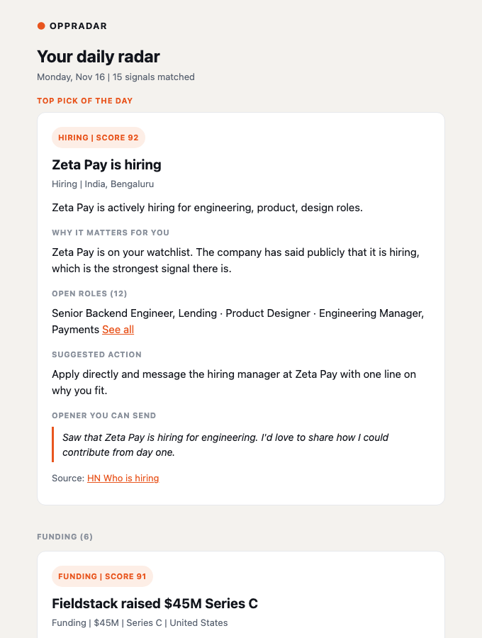
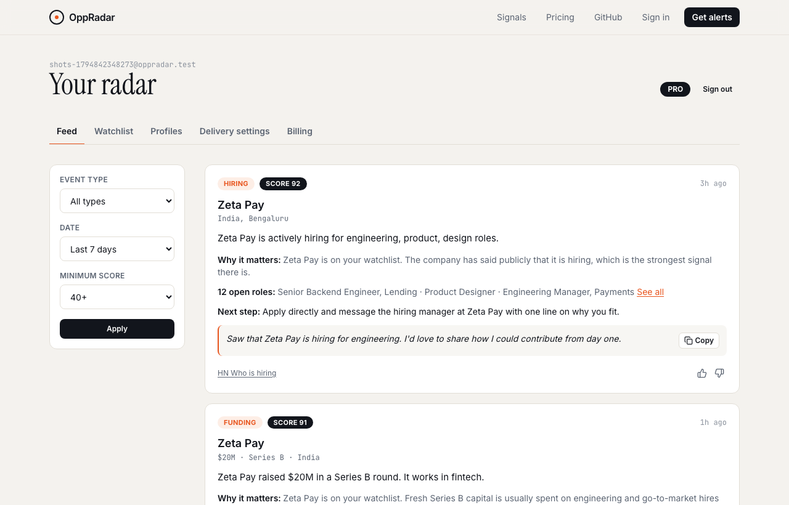
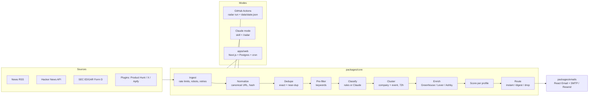

# OppRadar

**Every funding round is a job opening that hasn't been posted yet.**

OppRadar watches startup news, Hacker News and SEC filings for funding rounds, acquisitions,
expansions, leadership hires and hiring announcements, scores each one for _your_ role, and emails
you the ones that mean hiring: instantly for the strongest, in a daily digest for the rest.
Open source, runs free on GitHub Actions or your own Claude, or as a hosted web app.

[](https://github.com/rajnandanijain1401-code/opp-radar/actions/workflows/ci.yml)


<p align="center">
  
</p>

| Instant alert                                                                     | Daily digest                                                                      | Dashboard                                                                |
| --------------------------------------------------------------------------------- | --------------------------------------------------------------------------------- | ------------------------------------------------------------------------ |
|  |  |  |

## Why this exists

Most hiring starts weeks before a job is posted. A startup closes a Series B, opens a Bengaluru
office or hires a new CTO, and the roles follow. Job boards show you the opening after hundreds of
people have applied. OppRadar shows you the _trigger_, tells you why it matters for you, lists any
roles already open on the company's careers board, and suggests a one-line opener you can send the
same day.

## Features

- **Sources**: India and global startup news RSS (Inc42, Entrackr, YourStory, ET Tech, ET Startups,
  TechCrunch, Crunchbase News), Hacker News (Launch HN, raises, YC and the monthly _Who is hiring_
  thread), SEC EDGAR Form D filings. Optional bring-your-own-key plugins: Product Hunt, X API, Apify.
- **Polite ingestion**: descriptive User-Agent, `robots.txt` enforced, per-host rate limits, timeouts,
  retries with backoff. Stores only title, link and our own short summary.
- **Dedupe and clustering**: canonical URLs (UTM and tracking params stripped, Google News links
  decoded), near-duplicate titles (Jaccard on shingles), and event clusters (same company and event
  within 72h). You never get the same event twice.
- **Classification**: a free rules engine (93% event-type accuracy on the golden set) or Claude
  (`claude-haiku-5-5` by default) with batched, Zod-validated structured output, a per-item cache,
  one retry, rules fallback and a hard daily token budget.
- **Enrichment**: open roles from public Greenhouse, Lever and Ashby boards, cached for 24h.
- **Personal scoring**: `0.45 hiring likelihood + 0.35 relevance + 0.10 recency + 0.10 source quality`,
  with roles, sectors, geographies, keywords, watchlist (forces relevance 100) and exclusions.
- **Delivery**: instant alerts batched to one email per 15 minutes with a daily cap, daily or weekly
  digest at your local hour, React Email templates, SMTP (Gmail) or Resend, one-click unsubscribe.
- **Hosted app**: magic-link sign-in, 3-step onboarding with a "here's what you would have received"
  preview, dashboard with filters, copyable openers and feedback, public `/signals` pages for SEO,
  admin with source health, Razorpay and Stripe billing behind a flag, data export and deletion.

## Architecture



Everything that matters lives in `packages/core` as plain TypeScript, so all three modes behave
identically. `packages/cli` adds the state file and orchestration for OSS mode; `apps/web` adds
users, Postgres (Drizzle) and cron endpoints.

## Three ways to use it

|            | Self-host on GitHub Actions     | Run on your Claude       | Hosted                      |
| ---------- | ------------------------------- | ------------------------ | --------------------------- |
| Cost       | Free                            | Free (your Claude plan)  | Free beta, Pro later        |
| Classifier | Rules, or Claude API with a key | Claude itself            | Rules or Claude API         |
| Setup      | Fork, edit YAML, add 5 secrets  | Clone, `/radar`          | Sign up with your email     |
| Best for   | Set and forget                  | No API key, full control | Not wanting to run anything |

### 1. Self-host in 5 minutes (GitHub Actions + Gmail)

1. **Fork** this repo and enable Actions on your fork (Actions tab, "I understand my workflows").
2. **Edit `radar.config.yaml`**: your email in `recipients`, your roles, sectors, geographies,
   keywords and watchlist. Every field is commented.
3. **Create a Gmail App Password** (needed because Gmail blocks plain passwords for SMTP):
   1. Turn on 2-Step Verification at <https://myaccount.google.com/security>.
   2. Open <https://myaccount.google.com/apppasswords>, name it "OppRadar", click Create.
   3. Copy the 16-character password (spaces do not matter).
4. **Add repository secrets** (Settings, Secrets and variables, Actions):

   | Secret                | Value                                                  |
   | --------------------- | ------------------------------------------------------ |
   | `SMTP_HOST`           | `smtp.gmail.com`                                       |
   | `SMTP_PORT`           | `465`                                                  |
   | `SMTP_USER`           | your Gmail address                                     |
   | `SMTP_PASS`           | the App Password                                       |
   | `RADAR_FROM_EMAIL`    | `OppRadar <your.address@gmail.com>`                    |
   | `ANTHROPIC_API_KEY`   | optional; without it the free rules classifier is used |
   | `RADAR_CONTACT_EMAIL` | optional; a real email, enables SEC EDGAR Form D       |

5. **Run it**: Actions tab, "OppRadar", Run workflow (tick "Send the digest now" to see one
   immediately). After that it runs every 30 minutes and commits `data/state.json` back.

Try it locally first, no secrets needed:

```bash
pnpm install
RADAR_FIXTURES=1 RADAR_EMAIL_PROVIDER=console pnpm radar run
```

That prints a realistic instant alert and digest and writes them to `out/emails/`.

### 2. Run on your own Claude

No API key. Claude does the classification, the CLI does the rest.

```bash
git clone https://github.com/rajnandanijain1401-code/opp-radar.git && cd opp-radar
pnpm install
cp .env.example .env    # add SMTP_* from the Gmail steps above
pnpm radar test-email
```

Open the folder in Claude Code and type `/radar`. The skill in `.claude/skills/opp-radar/SKILL.md`
runs `pnpm radar fetch --json --since-state`, classifies each item into the Signal schema, and runs
`pnpm radar send --input out/classified.json`. See [docs/claude-mode.md](docs/claude-mode.md) for a
paste-ready prompt to run it as a Claude scheduled task.

### 3. Hosted

Sign up with your email on the hosted site, pick roles, sectors and companies, and you are done.
To run your own instance (Vercel + Neon + Resend + Razorpay/Stripe), follow
[docs/deploy.md](docs/deploy.md). Local development:

```bash
pnpm install
pnpm dev     # http://localhost:3000, embedded Postgres, magic links printed in the terminal
```

## CLI

```bash
pnpm radar run [--force-digest] [--dry-run]   # full pipeline + email + state
pnpm radar fetch --json [--since-state]       # new, deduped, pre-filtered candidates
pnpm radar classify --input out/candidates.json --json
pnpm radar send --input out/classified.json   # validate, score, route, email, update state
pnpm radar preview                            # render digest to out/preview.html
pnpm radar test-email [--to you@example.com]
pnpm radar sources check [--all]              # live status of every source
pnpm eval                                     # golden-set precision per event type
```

Add `--fixtures` (or `RADAR_FIXTURES=1`) to any command to use recorded fixtures instead of the network.

## Configuration reference

`radar.config.yaml` (OSS and Claude modes):

| Key                                                                            | Default                        | Meaning                                                                                                |
| ------------------------------------------------------------------------------ | ------------------------------ | ------------------------------------------------------------------------------------------------------ |
| `mode`                                                                         | `llm`                          | `llm` uses Claude when `ANTHROPIC_API_KEY` is set, else rules; `rules` never calls an API              |
| `recipients`                                                                   | required                       | Who gets the emails                                                                                    |
| `profile.roles`                                                                | `[]`                           | `engineering, product, design, data, sales, marketing, ops, finance, hr, customer_success, leadership` |
| `profile.sectors` / `geographies`                                              | `[]`                           | Lowercase sector tags / countries and cities (`Remote` matches anything)                               |
| `profile.include_keywords` / `exclude_keywords`                                | `[]`                           | Bonus terms / terms that drop an item entirely                                                         |
| `profile.watchlist_companies`                                                  | `[]`                           | Any news about these gets relevance 100                                                                |
| `profile.event_types`                                                          | `[]` (all)                     | Limit to some event types                                                                              |
| `profile.min_amount_usd`                                                       | `null`                         | Ignore smaller funding rounds                                                                          |
| `profile.instant_alerts_enabled` / `instant_threshold` / `max_instant_per_day` | `true` / `75` / `5`            | Instant alert rules                                                                                    |
| `profile.digest_frequency` / `digest_hour_local` / `timezone`                  | `daily` / `8` / `Asia/Kolkata` | Digest timing                                                                                          |
| `digest_max_items`                                                             | `15`                           | Items per digest                                                                                       |
| `sources.enable` / `sources.disable`                                           | `[]`                           | Override `sources.yaml` per source id                                                                  |
| `scoring.weights`                                                              | `0.45 / 0.35 / 0.10 / 0.10`    | Hiring, relevance, recency, source quality                                                             |
| `scoring.digest_min_score`                                                     | `40`                           | Below this an item is dropped                                                                          |
| `llm.model` / `llm.daily_token_budget`                                         | `claude-haiku-5-5` / `400000`  | Overridden by `RADAR_MODEL` / `LLM_DAILY_TOKEN_BUDGET`                                                 |

Environment variables are listed in [`.env.example`](.env.example) (CLI) and
[`apps/web/.env.example`](apps/web/.env.example) (hosted).

## Sources

| Source                                                   | Kind        | Status                                         |
| -------------------------------------------------------- | ----------- | ---------------------------------------------- |
| Inc42, Entrackr, YourStory, ET Tech, ET Startups         | RSS         | Enabled                                        |
| TechCrunch Venture, TechCrunch Startups, Crunchbase News | RSS         | Enabled                                        |
| Hacker News (Launch HN, raises, YC)                      | Algolia API | Enabled                                        |
| HN _Who is hiring_ (company + roles only)                | Algolia API | Enabled                                        |
| SEC EDGAR Form D                                         | Atom feed   | Enabled (needs `RADAR_CONTACT_EMAIL`)          |
| Google News search (templates + watchlist queries)       | RSS         | Disabled: `robots.txt` disallows `/rss/search` |
| Reddit r/startups, r/IndianStartups, r/SaaS              | JSON        | Disabled: 403 to unauthenticated clients       |
| VCCircle, Business Standard, Moneycontrol                | RSS         | Disabled: 404 / 403 / stale feed               |
| Product Hunt, X API, Apify                               | Plugin      | Off by default, bring your own key             |

Every decision behind this table is in [DECISIONS.md](DECISIONS.md). To add a source, follow the
adapter guide in [CONTRIBUTING.md](CONTRIBUTING.md#adding-a-source): an RSS feed is a three-line
entry in `sources.yaml`; anything else is one adapter file with a fixture test.

## Compliance

- OppRadar does **not** scrape LinkedIn, X/Twitter, Instagram or Facebook, and never bypasses logins
  or paywalls. Optional plugins use official APIs with your own keys, and you are responsible for
  complying with those platforms' terms.
- `robots.txt` is checked before every request; sources that disallow us ship disabled.
- Requests use a descriptive User-Agent and per-host rate limits.
- Only headlines, links and summaries written in our own words are stored or emailed. Never full
  article text. Every item links to the original publisher.
- Emails carry `List-Unsubscribe` and one-click `List-Unsubscribe-Post` headers, a postal address,
  and why you are receiving them. Bounces and complaints auto-suppress addresses.
- Hosted users can export or delete all their data (DPDP and GDPR friendly).

## Roadmap

- Form D amounts from the filing XML, and more filings (MCA in India, Companies House in the UK)
- Weekly "company momentum" view: multiple signals for the same company over a month
- Slack and WhatsApp delivery
- Learning from 👍/👎 feedback to tune relevance per user
- Contact suggestions for the hiring manager behind each signal (opt-in, compliant sources only)

## Contributing

PRs welcome, especially new sources and golden-set headlines. See [CONTRIBUTING.md](CONTRIBUTING.md)
and the [Code of Conduct](CODE_OF_CONDUCT.md). Run `pnpm lint && pnpm typecheck && pnpm test` before
opening a PR.

## License

[MIT](LICENSE)
